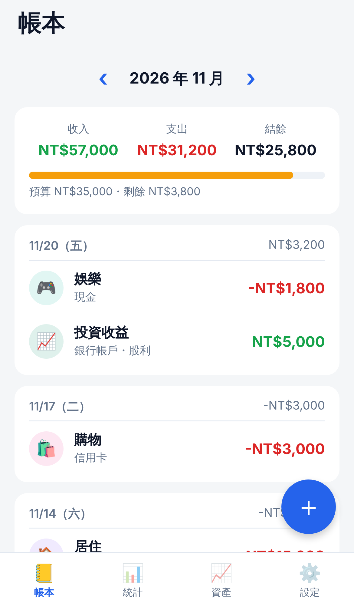
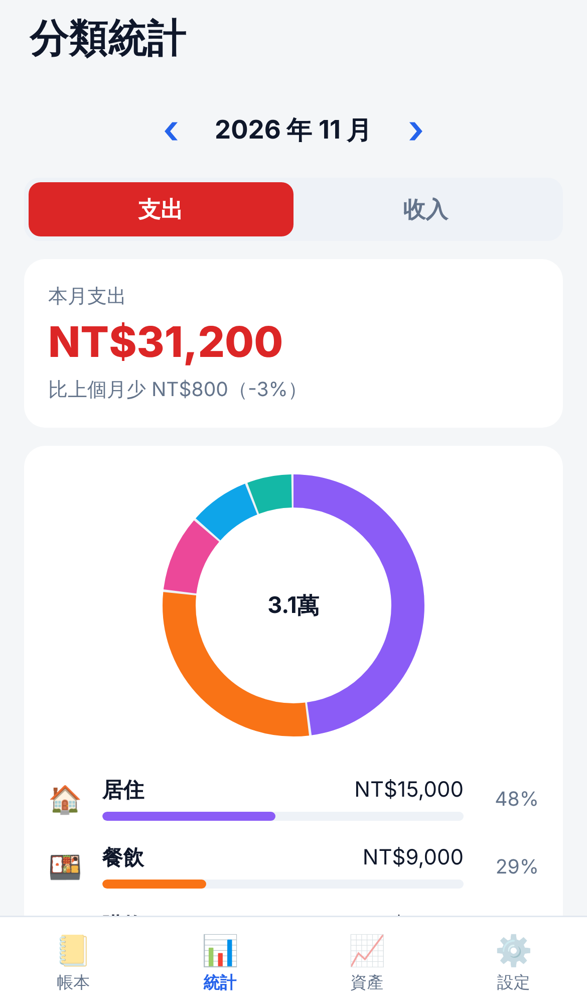
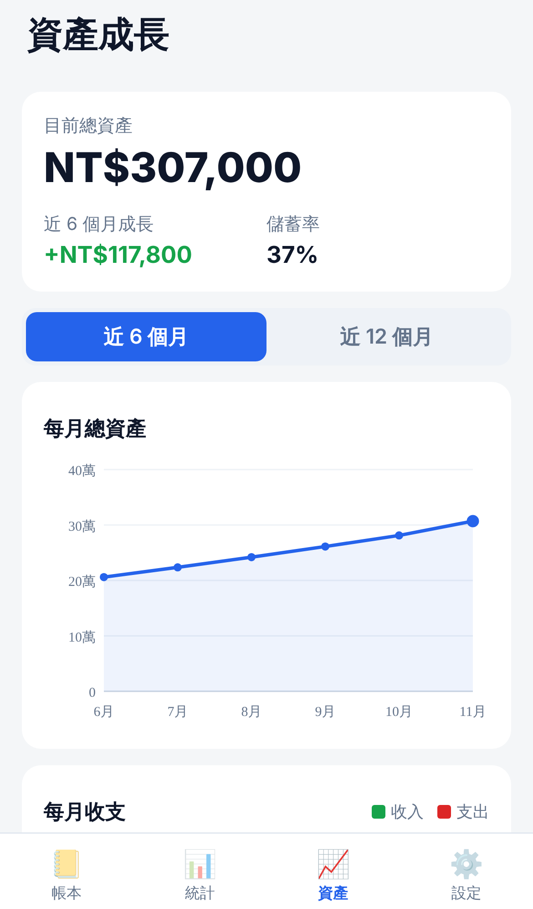

# 資金成長記帳（手機 App）

個人收支與資金成長紀錄工具，使用 Expo（React Native）開發，iPhone 與 Android 都能用。資料只存在手機本機，不需要帳號、不上傳雲端。幣別為新台幣（TWD）。

| 帳本 | 記一筆 | 分類統計 | 資產成長 |
| --- | --- | --- | --- |
|  |  |  |  |

## 功能（第一版）

- **帳本**：手動記收入／支出（金額、分類、帳戶、日期、備註），依月份與日期瀏覽，點一筆可編輯或刪除；設定預算後顯示本月預算進度。
- **統計**：每月各分類的金額與占比（甜甜圈圖），並和上個月比較。
- **資產**：目前總資產、每月月底總資產的成長曲線、每月收入 vs 支出、儲蓄率、各帳戶餘額。
- **設定**：自訂分類（名稱、表情符號、顏色）、帳戶與期初餘額（信用卡等欠款可輸入負數）、每月預算、匯出／匯入備份、清除資料。

> 總資產 = 所有帳戶的期初餘額 + 截至該日的收入 − 支出。

## 在手機上試用

1. 在手機安裝 **Expo Go**（App Store / Google Play 搜尋「Expo Go」）。
2. 電腦需要安裝 [Node.js](https://nodejs.org)（建議 LTS 版），然後：

   ```bash
   git clone https://github.com/mx9201624950-commits/github-test.git
   cd github-test/finance-app
   npm install
   npx expo start
   ```

3. 終端機會出現 QR code：
   - **iPhone**：用相機掃描，點跳出的通知開啟 Expo Go。
   - **Android**：打開 Expo Go，點「Scan QR code」掃描。
4. 手機和電腦要在同一個 Wi-Fi；如果連不上，改用 `npx expo start --tunnel`。

也可以在電腦瀏覽器預覽：`npx expo start --web`。

## 專案結構

```
App.tsx                 底部分頁（帳本／統計／資產／設定）
src/types.ts            資料型別
src/store.tsx           資料狀態與本機儲存（AsyncStorage）
src/calc.ts             統計與資產計算
src/screens/            各頁面
src/components/         共用元件、圖表（react-native-svg）、記帳表單
```

## 之後可以加的功能

- 帳戶間轉帳、信用卡繳款
- 投資帳戶手動更新市值（資產快照）
- 匯入銀行／記帳 App 的 CSV
- 雲端同步與多裝置
- 正式上架（EAS Build）
